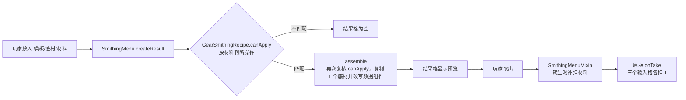

# 架构说明

本文描述 Gear Forge 当前（1.6.51，2026-11 二次整理后）的代码结构和各子系统如何协作。术语以 [GLOSSARY.md](../GLOSSARY.md) 为准，重要决策的理由见 [adr/](adr/)。

## 1. 技术栈

| 项 | 版本 / 选择 |
|---|---|
| Minecraft | 1.21.1 |
| 加载器 | NeoForge 21.1.228（FML 4.0.42） |
| 构建 | Gradle 9.2.0 wrapper（阿里云镜像），ModDevGradle 2.0.141，Parchment 2024.11.17 |
| Java | 21（Gradle toolchain 固定） |
| 依赖 | Curios 9.5.1（编译期只用 API，运行期必需，见 ADR-0005） |
| 字节码修改 | Mixin，2 个注入点（见第 6 节） |

## 2. 包结构

```
com.hana.gear_forge
├── GearForgeMod            入口：加载配置、注册所有 DeferredRegister
├── component/              数据组件定义（装备状态）
├── config/                 四份 JSON 配置的模型类和加载/合并/同步逻辑（ModConfigs）
├── recipe/                 GearSmithingRecipe（全部锻造操作）和它的序列化器
├── item/                   物品、创造模式标签页；item/custom/ 是材料物品（提示文本 + 右键提示去锻造台）
├── compat/curios/          两个饰品物品（实现 ICurioItem）
├── content/                ModEnchantments：7 个附魔的 ResourceKey 常量
├── event/                  游戏事件处理：属性、伤害、掉落、经验、附魔行为、饰品、怪物装备、命令注册
├── client/                 仅客户端的监听器：tip 文本、附魔说明、断线恢复本地配置
├── network/                配置同步 payload 与登录时下发
├── mixin/                  LivingEntityMixin（弓蓄力）、SmithingMenuMixin（转生材料扣除）
├── loot/                   AddItemModifier（全局战利品修改器）与其序列化器注册
├── command/                /gear_forge test spawnmob 调试命令
├── datagen/                GatherDataEvent 入口；datagen/provider/ 是三个数据生成 provider
└── util/GearHelper         词条抽取、数值汇总、装备判定、耐久系数等纯逻辑
```

> 包名全部小写。`compat/curios` 单独成包是为了让"唯一一处硬依赖 Curios"在目录层面可见（ADR-0005）。

资源分两处：

- `src/main/resources/`：手写资源（语言、贴图、附魔定义、物品标签、战利品修改器、Curios 实体槽位与物品标签、mixin 配置）。
- `src/generated/resources/`：`runData` 生成的资源（14 个物品模型、12 个合成配方与进度、Curios 槽位）。不要手改，也不要在 `src/main/resources` 放同路径文件（ADR-0006）。

`src/main/templates/META-INF/neoforge.mods.toml` 是模组元数据模板，构建时由 `generateModMetadata` 用 `gradle.properties` 里的值展开。

## 3. 启动与注册

`GearForgeMod` 构造函数依次做两件事：

1. `ModConfigs.init()`：读取 `config/gear_forge/*.json`。文件不存在就写入默认值；存在就和默认值合并——**用户已有的值（包括数组）一律保留**，默认值只用来补全缺失的键。只有补全真的改动了内容时才写回，并把改动前的原文备份为 `.old`。
2. 注册 `DeferredRegister`：数据组件、创造标签页、配方序列化器、物品、GLM 序列化器。

### 事件总线

所有 `@EventBusSubscriber` 类只指定 `modid`（`GearEventHandlers.ClientEvents`、`EnchantmentTooltips`、`ClientConfigSync` 另加 `value = Dist.CLIENT`）。

`bus` 属性在 1.21.1 起已 `@Deprecated(forRemoval = true)`，且 FML 4.0.42 **完全不读它**。真正的分流发生在 `AutomaticEventSubscriber.inject`：它按每个 `@SubscribeEvent` 方法**第一个参数的类型**判断——参数实现 `IModBusEvent` 的进 mod 总线，否则进游戏总线；同一个类里两者都有时逐方法拆开分别注册。因此 `DataGenerators`（`GatherDataEvent implements IModBusEvent`）自动进 mod 总线，`ModNetwork`（`RegisterPayloadHandlersEvent`）同理，其余游戏事件类自动进游戏总线。写 `bus = Bus.MOD` 是静默无效的。

Dist 过滤发生在 `Class.forName` 之前，所以带 `value = Dist.CLIENT` 的类在专用服务器上根本不会被加载。

### 配置生命周期

配置只在启动时从磁盘读一次。服务端在玩家登录时下发快照（见第 4 节）。`ModConfigs.reload()` 会重新读磁盘，当前由客户端断线事件调用；服务端侧的热重载入口是 `ConfigSyncEvents.broadcast()`，尚未接 `/reload` 命令。

## 4. 数据模型

装备的全部锻造状态都存在物品的数据组件里（ADR-0002）：

| 组件 | 类型 | 含义 |
|---|---|---|
| `gear_forge:upgrade_level` | int | 强化等级 |
| `gear_forge:affixes` | List<{id, value}> | 词条 |
| `gear_forge:gems` | List<{id, tier}> | 已镶嵌的宝石 |
| `gear_forge:gem_tier` | int | 宝石物品自身的阶级 |
| `gear_forge:offhand_mode` | bool | 副手模式 |
| `gear_forge:reincarnation_count` | int | 转生次数 |
| `gear_forge:stored_bonuses` | List<{id, value}> | 转生保留奖励 |
| `gear_forge:roll_salt` | int | 重铸盐值（ADR-0008） |

组件里只存 id 和数值。词条叫什么、是什么类型、宝石有哪些效果，都在运行时用 id 去配置里查（`ModConfigs.getAffixDefinition` / `getGemDefinition`）。因此改配置会立刻改变已有装备的效果；从配置里删掉一个 id，带这个 id 的装备会静默失效。

配置文件（ADR-0003）：

| 文件 | 内容 | 实际被使用的字段 |
|---|---|---|
| `affixes.json` | 词条池、词条数量范围 | `minAffixCount`、`maxAffixCount`、`affixPool`。`rarityAffixCount`、`affixRerollCostDiamonds` 仍未使用（GF-004） |
| `gems.json` | 宝石定义、插槽数、阶级上限 | `maxSocketsPerGear`、`gems`、`maxTier`。`socketTypes` 未使用 |
| `upgrades.json` | 强化和转生 | 全部字段。`maxLevel`、`statBoostPerLevel`、里程碑奖励、转生字段；强化侧的成功率（`baseSuccessRate` / `levelSuccessDecay`）、降级（`allowDowngrade` / `downgradeLevels` / `levelFailureDecay`）、损毁（`allowDestroy` / `destroyChance`）、材料消耗（`consumeMaterial` / `consumeAmountBase` / `consumeAmountIncrement` / `maxConsumeMaterialPerLevel`）均已接入（ADR-0009） |
| `mob_gear.json` | 强化怪物概率和上限 | 5 个字段全部 |

四份文件共有的 `configVersion` 目前没有任何读取方。

### 配置同步（ADR-0007）

服务端持有权威值。玩家登录时 `ConfigSyncEvents` 用 `gear_forge:config_sync` payload 把四份 JSON 的文本快照发过去，客户端 `ModConfigs.applyServerSnapshot` 只覆盖内存、不写回文件；断线时 `ClientConfigSync` 调 `ModConfigs.reload()` 恢复本地值。任何一段解析失败都保留原有值。

`ModConfigs` 用读写锁保护成组替换（配置对象 + 两张 id 索引表），因为每 tick 的伤害结算与 tooltip 都在读。

## 5. 锻造流程

整个模组只有一个锻造配方 `gear_forge:gear_smithing`（`data/gear_forge/recipe/gear_smithing.json`），类型是原版 `RecipeType.SMITHING`，没有自己的方块和界面（ADR-0001）。另有两个 switch 条件相关的 `ItemAttributeModifiers` 之外，模组没有自己的方块。



`canApply` 是分派逻辑的**唯一真源**：`matches` 和 `assemble` 都调用它。`assemble` 不再依赖"调用方已经走过 `matches`"，任何直接调用（配方书预览、其它 mod 的机器方块、脚本）都会得到合法结果或空产物，而不是越界加成或原样复制底材。

分派顺序：锻造锤 → 重铸石 → 宝石镶嵌 → 宝石升阶 → 副手切换 → 附魔书 → 宝石摘除 → 转生石。

几个由"借用原版锻造台"带来的约束：

- 原版取出时三个输入格各只扣 1 个，所以 `assemble` 必须只产出 1 个（否则整组底材会被复制），需要多个材料的操作（转生）要靠 `SmithingMenuMixin` 补扣。补扣的条件是"产物上的 `reincarnation_count` 比底材多 1"，不看材料槽，因此不会被别的操作误触发。
- **除转生外，所有操作的模板槽必须为空**。原版无条件扣模板槽，如果允许在模板槽放钻石/下界合金块，每次操作都会白吞一个。
- 结果在放入物品时就算出并显示。重铸用的是盐值派生的确定种子，反复放取不会得到不同结果（ADR-0008）。
- 宝石镶嵌分支要求模板槽为空，否则会抢占原版"钻石纹饰"配方并吞掉纹饰模板。
- 强化的成功率/降级/损毁/材料消耗全部由 `upgrades.json` 决定（ADR-0009）。预览固定显示 +1，真正的掷骰在取出时（`SmithingMenuMixin.onTake`）发生，所以预览不能刷、客户端也不参与结算。默认配置下 0→5 级必成（合计 15 钻石），6→15 级成功率 75%→30%、每级 5 钻石。
- 配方标记为 `isSpecial() = true`，产物由输入动态决定，不进入配方书。

## 6. 效果结算

装备上的数值通过两条路径生效，规则是同一项数值只走一条（ADR-0004）：

**属性修饰符**（`GearEventHandlers.onItemAttributeModifiers`）：原版能表达的属性直接挂到物品上，由原版负责叠加、显示和移除。

- 词条：攻击力、攻速、护甲、移速、生命上限、击退、幸运
- 强化：攻击、护甲、韧性
- 宝石：移速、攻击力、护甲、全属性（护甲 / 幸运 / 攻击力 / 生命，各 +1）
- 转生保留：对应的上述各项，外加 `max_health` / `luck` / `knockback_boost`

生效槽位：盔甲只在自己的护甲槽；其它装备在主手，开启副手模式后在副手。修饰符 id 带槽位后缀（例如 `gear_forge:upgrade_defense/head`），因为原版按 id 合并修饰符，同 id 的几件盔甲只会生效一件。

**事件钩子**：原版没有对应属性的效果。

| 事件 | 处理内容 |
|---|---|
| `LivingDamageEvent.Pre`（攻击方） | 暴击、火焰/寒冰/雷电/附魔增幅等额外伤害、护甲穿透、生命偷取、灼烧和减速；箭矢伤害走 `handleRangedProjectileDamage`，取射出这支箭的弓 |
| `LivingIncomingDamageEvent`（受击方） | 下界之星抗性、百分比减伤、闪避、荆棘反伤、盾牌格挡减伤。`#bypasses_invulnerability`（虚空、`/kill`）直接跳过；`#bypasses_armor`（摔落、溺水、饥饿、魔法、凋零、冻结）**跳过固定减伤与闪避**，因为这些伤害本来就不看护甲 |
| `LivingDropsEvent` | 掠夺词条/宝石额外复制普通掉落（玩家死亡、装备类、容器类、药水、书类不参与；额外次数上限 3） |
| `LivingExperienceDropEvent` | 经验加成词条 |
| `PlayerTickEvent.Post`（每 20 tick） | 生命回复、`auto_repair` 自动修复 |
| `ArmorHurtEvent` | 耐久损耗减免（统一走 `GearHelper.durabilityDamageFactor`，系数钳制在 `[0.05, 1]`） |
| `LivingEntityMixin`（`aiStep` 末尾） | 弓/弩蓄力加速：用小数累加器按配置数值推进 `useItemRemaining`，不再"有加成即翻倍" |

提示文本（`GearEventHandlers.ClientEvents.onItemTooltip`）只在客户端注册，读取的是当前生效的配置（联机时即服务端下发的快照）。

## 7. 附魔

7 个附魔定义在 `data/gear_forge/enchantment/*.json`，只声明适用物品、等级上限和权重，没有任何原版 effect 组件，行为全部写在 `ModEnchantmentEvents`：

- 箭矢附魔（闪电、霜冻、爆炸、破甲）：`ProjectileImpactEvent` 和 `LivingIncomingDamageEvent`。发射武器优先取箭上记录的 `getWeaponItem()`，射出后换手不影响判定。伤害一律用 `setAmount` / `addReductionModifier` 原地修改，**不再在伤害事件里嵌套 `hurt()`**（嵌套会占无敌帧、抵消外层箭伤、并让创造模式被扣血）。
- 挖掘附魔（挖矿暴击、矿石猎手、丰收暴击）：`BlockDropsEvent`，在掉落已判定后追加/替换列表。**不取消方块破坏**——取消会跳过 `playerWillDestroy`（潜影盒内容）、`mineBlock`（耐久）、`playerDestroy`（战利品表/方块经验/其它 mod 的 GLM），还能绕过保护类 mod 的取消。丰收附魔只对已成熟作物生效。
- 弓弩附魔的 `supported_items` 指向自定义标签 `#gear_forge:enchantable/arrow_weapons`（内含 `enchantable/bow` 与 `enchantable/crossbow`），因为 `HolderSet` 的数组写法不接受标签条目，写成数组会直接让服务器加载失败。
- 所有附魔等级读取都走 `registry.getHolder(key)` 返回的 `Optional`，数据包删掉附魔时返回 0 而不是抛异常刷屏。

`ModEnchantments` 里还有一个 `charity_bundle` 键，没有对应的附魔文件（GF-011）。

## 8. 饰品与 Curios

- `hhthing` 槽位：4 格，死亡保留，`curios/slots/hhthing.json` 由 `CuriosProvider` 生成（图标用 `curios:slot/empty_curio_slot`，Curios 9.5.1 里存在）；`curios/entities/playerslots.json` 手写，把它和常用槽位一起开放给玩家；`data/curios/tags/item/hhthing.json` 把两个饰品放进这个槽。
- 幸运钻石：幸运 +20。
- 魔性铁砧：每 5 秒让 10 格内非敌对生物仇恨玩家；经验获取 +15%；附魔台附魔等级 -5（`CuriosEventHandler`）。

## 9. 战利品与怪物

- 全局战利品修改器 `gear_forge:add_item`：村庄武器匠 / 工具匠箱各 2% 魔性铁砧，废弃矿井 5% 幸运钻石，地牢箱子 5% 幸运钻石（GF-009 已从 100% 调回）。
- `LootModEvents`：僵尸 2% 掉落幸运钻石，`EventPriority.LOWEST` 且只认玩家击杀，避免被掠夺复制逻辑看到。
- `MobGearEventHandler`：怪物加入世界时按难度概率给装备随机强化等级和词条。用 `EntityJoinLevelEvent`，因为 `FinalizeSpawnEvent` 触发时怪物还没拿到默认装备。只在真的强化时才写持久标记，避免每只怪都往存档塞一条 NBT。

## 10. 调试命令

`/gear_forge test spawnmob <实体> [数量 1-64] [装备件数 1-6] [强化等级] [词条数]`（需要 2 级权限）。实体 id 支持带命名空间。强化等级和词条数可以写成单个数字（所有槽位相同）或 `槽位:值,...`（槽位 1 主手、2 副手、3-6 头胸腿脚）。生成的实体带强化怪物标记，不会再被随机装备覆盖。

## 11. 数据生成

`DataGenerators` 注册三个 provider：物品模型（客户端，14 个）、配方（服务端）、Curios 槽位（服务端）。运行 `./gradlew runData` 输出到 `src/generated/resources`，并通过 `--existing src/main/resources` 校验引用的贴图存在。
