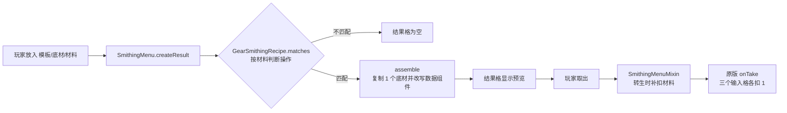

# 架构说明

本文描述 Gear Forge 当前（1.6.51，2026-11 整理后）的代码结构和各子系统如何协作。术语以 [GLOSSARY.md](../GLOSSARY.md) 为准，重要决策的理由见 [adr/](adr/)。

## 1. 技术栈

| 项 | 版本 / 选择 |
|---|---|
| Minecraft | 1.21.1 |
| 加载器 | NeoForge 21.1.228（FML 4.0.42） |
| 构建 | Gradle 9.2.0 wrapper（阿里云镜像），ModDevGradle 2.0.141，Parchment 2024.11.17 |
| Java | 21（Gradle toolchain 固定） |
| 依赖 | Curios 9.5.1（编译期只用 API，运行期必需，见 ADR-0005） |
| 字节码修改 | Mixin，2 个注入点（见第 6 节） |

## 2. 包结构

```
com.hana.gear_forge
├── GearForgeMod            入口：加载配置、注册所有 DeferredRegister
├── component/              数据组件定义（装备状态）、GLM 序列化器注册
├── config/                 四份 JSON 配置的模型类和加载/合并逻辑（ModConfigs）
├── recipe/                 GearSmithingRecipe（全部锻造操作）和它的序列化器
├── item/                   物品、创造模式标签页；item/custom/ 是只带提示文本的材料物品
├── Curios/                 两个饰品物品（实现 ICurioItem）
├── event/                  游戏事件处理：属性、伤害、掉落、经验、附魔、饰品、怪物装备、命令注册
├── mixin/                  LivingEntityMixin（弓蓄力）、SmithingMenuMixin（转生材料扣除）
├── loot/                   AddItemModifier（全局战利品修改器）
├── command/                /gear_forge test spawnmob 调试命令
├── Provider/               附魔 ResourceKey 常量 + 数据生成 provider（命名问题见 GF-020）
├── datagen/                GatherDataEvent 入口
└── util/GearHelper         词条抽取、数值汇总、装备判定等纯逻辑
```

资源分两处：

- `src/main/resources/`：手写资源（语言、贴图、附魔定义、战利品修改器、饰品物品模型、Curios 标签和实体槽位、mixin 配置）。
- `src/generated/resources/`：`runData` 生成的资源（12 个物品模型、配方和配方进度、Curios 槽位）。不要手改，也不要在 `src/main/resources` 放同路径文件（ADR-0006）。

`src/main/templates/META-INF/neoforge.mods.toml` 是模组元数据模板，构建时由 `generateModMetadata` 用 `gradle.properties` 里的值展开。

## 3. 启动与注册

`GearForgeMod` 构造函数依次做两件事：

1. `ModConfigs.init()`：读取 `config/gear_forge/*.json`。文件不存在就写入默认值；存在就和默认值合并后写回，并把原文件备份为 `.old`。之后建立词条和宝石的 id 索引。
2. 注册 `DeferredRegister`：数据组件、创造标签页、配方序列化器、物品、GLM 序列化器。

所有 `@EventBusSubscriber` 类都只写了 `modid`。FML 4.0.42 会按事件类型自动分流：`IModBusEvent`（例如 `GatherDataEvent`）进 mod 总线，其余进游戏总线。

配置只在启动时加载一次。`ModConfigs.reload()` 存在但没有任何调用方，改配置需要重启。

## 4. 数据模型

装备的全部锻造状态都存在物品的数据组件里（ADR-0002）：

| 组件 | 类型 | 含义 |
|---|---|---|
| `gear_forge:upgrade_level` | int | 强化等级 |
| `gear_forge:affixes` | List<{id, value}> | 词条 |
| `gear_forge:gems` | List<{id, tier}> | 已镶嵌的宝石 |
| `gear_forge:gem_tier` | int | 宝石物品自身的阶级 |
| `gear_forge:offhand_mode` | bool | 副手模式 |
| `gear_forge:reincarnation_count` | int | 转生次数 |
| `gear_forge:stored_bonuses` | List<{id, value}> | 转生保留奖励 |

组件里只存 id 和数值。词条叫什么、是什么类型、宝石有哪些效果，都在运行时用 id 去配置里查（`ModConfigs.getAffixDefinition` / `getGemDefinition`）。因此改配置会立刻改变已有装备的效果；从配置里删掉一个 id，带这个 id 的装备会静默失效。

配置文件（ADR-0003）：

| 文件 | 内容 | 实际被使用的字段 |
|---|---|---|
| `affixes.json` | 词条池、词条数量范围 | `minAffixCount`、`maxAffixCount`、`affixPool`。`rarityAffixCount`、`affixRerollCostDiamonds` 未使用（GF-004） |
| `gems.json` | 宝石定义、插槽数、阶级上限 | `maxSocketsPerGear`、`gems`、`maxTier`。`socketTypes` 未使用 |
| `upgrades.json` | 强化和转生 | `maxLevel`、`statBoostPerLevel`、里程碑奖励、转生相关字段。成功率、降级、损毁、材料消耗共 11 个字段未使用（GF-001） |
| `mob_gear.json` | 强化怪物概率和上限 | 全部 |

配置只存在于各自的实例里，**不会从服务端同步到客户端**（GF-007）。

## 5. 锻造流程

整个模组只有一个配方 `gear_forge:gear_smithing`（`data/gear_forge/recipe/gear_smithing.json`），类型是原版 `RecipeType.SMITHING`，没有自己的方块和界面（ADR-0001）。



`matches` 和 `assemble` 里是同一套按材料分派的 if 链，顺序为：锻造锤 → 重铸石 → 宝石 → 升阶水晶 → 转移宝珠 → 附魔书 → 宝石摘除器 → 转生石。

几个由“借用原版锻造台”带来的约束：

- 原版取出时三个输入格各只扣 1 个，所以 `assemble` 必须只产出 1 个（否则整组底材会被复制），需要多个材料的操作（转生）要靠 mixin 补扣。
- 结果在放入物品时就算出来并显示，取出前可以反复看。重铸用的是每次新建的随机源，所以反复放取可以刷出任意词条（GF-002）。
- 强化永远成功，模板格可以空着，不消耗钻石（GF-001）。

## 6. 效果结算

装备上的数值通过两条路径生效，规则是同一项数值只走一条（ADR-0004）：

**属性修饰符**（`GearEventHandlers.onItemAttributeModifiers`）：原版能表达的属性直接挂到物品上，由原版负责叠加、显示和移除。

- 词条：攻击力、攻速、护甲、移速、生命上限、击退、幸运
- 强化：攻击、护甲、韧性
- 宝石：移速、全属性（护甲 / 幸运 / 生命）
- 转生保留：对应的上述各项

生效槽位：盔甲只在自己的护甲槽；其它装备在主手，开启副手模式后在副手。修饰符 id 带槽位后缀（例如 `gear_forge:upgrade_defense/head`），因为原版按 id 合并修饰符，同 id 的几件盔甲只会生效一件。

**事件钩子**：原版没有对应属性的效果。

| 事件 | 处理内容 |
|---|---|
| `LivingDamageEvent.Pre`（攻击方） | 暴击、火焰/寒冰/雷电/附魔增幅等额外伤害、护甲穿透、宝石攻击、生命偷取、灼烧和减速；箭矢伤害走 `handleRangedProjectileDamage`，取射出这支箭的弓 |
| `LivingIncomingDamageEvent`（受击方） | 宝石固定减伤、全属性减伤、下界之星抗性、百分比减伤、闪避、荆棘反伤、盾牌格挡减伤。虚空和 `/kill` 类伤害直接跳过 |
| `LivingDropsEvent` | 掠夺词条/宝石额外复制普通掉落（玩家死亡和装备类掉落不参与） |
| `LivingExperienceDropEvent` | 经验加成词条 |
| `PlayerTickEvent.Post`（每 20 tick） | 生命回复、自动修复、翡翠耐久回复 |
| `ArmorHurtEvent` | 耐久保护、翡翠减少盔甲耐久损耗 |
| `LivingEntityMixin`（`aiStep` 末尾） | 弓/弩蓄力加速：额外减少 `useItemRemaining` |

提示文本（`GearEventHandlers.ClientEvents.onItemTooltip`）只在客户端注册，读取的是客户端本地配置。

## 7. 附魔

7 个附魔定义在 `data/gear_forge/enchantment/*.json`，只声明适用物品、等级上限和权重，没有任何原版 effect 组件，行为全部写在 `ModEnchantmentEvents`：

- 箭矢附魔（闪电、霜冻、爆炸、破甲）：`ProjectileImpactEvent` 和 `LivingIncomingDamageEvent`。实现问题见 GF-005。
- 挖掘附魔（挖矿暴击、矿石猎手、丰收暴击）：`BlockEvent.BreakEvent`，通过取消原版破坏、自己放掉落物实现。实现问题见 GF-006。

`ModEnchantments` 里还有一个 `charity_bundle` 键，没有对应的附魔文件。

## 8. 饰品与 Curios

- `hhthing` 槽位：4 格，死亡保留，`curios/slots/hhthing.json` 由 `CuriosProvider` 生成；`curios/entities/playerslots.json` 手写，把它和常用槽位一起开放给玩家；`data/curios/tags/item/hhthing.json` 把两个饰品放进这个槽。
- 幸运钻石：幸运 +20。
- 魔性铁砧：每 5 秒让 10 格内非敌对生物仇恨玩家；经验获取 +15%；附魔台附魔等级 -5（`CuriosEventHandler`）。

## 9. 战利品与怪物

- 全局战利品修改器 `gear_forge:add_item`：村庄铁匠箱 2% 魔性铁砧，废弃矿井 5% 幸运钻石，地牢箱子 100% 幸运钻石（GF-009）。
- `LootModEvents`：僵尸 2% 掉落幸运钻石。
- `MobGearEventHandler`：怪物加入世界时按难度概率给装备随机强化等级和词条。用 `EntityJoinLevelEvent`，因为 `FinalizeSpawnEvent` 触发时怪物还没拿到默认装备。

## 10. 调试命令

`/gear_forge test spawnmob <实体> [数量] [装备件数 1-6] [强化等级] [词条数]`（需要 2 级权限）。强化等级和词条数可以写成单个数字（所有槽位相同）或 `槽位:值,...`（槽位 1 主手、2 副手、3-6 头胸腿脚）。生成的实体带强化怪物标记，不会再被随机装备覆盖。

## 11. 数据生成

`DataGenerators` 注册三个 provider：物品模型（客户端）、配方（服务端）、Curios 槽位（服务端）。运行 `./gradlew runData` 输出到 `src/generated/resources`，并通过 `--existing src/main/resources` 校验引用的贴图存在。
